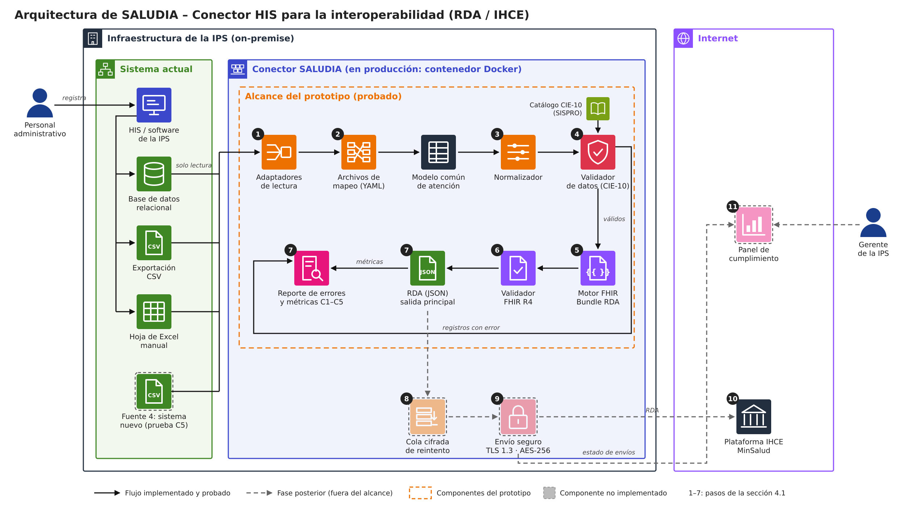

# SALUDIA · Conector HIS → RDA (HL7 FHIR R4)

> **Prototipo académico · datos sintéticos · validación estructural FHIR R4.**
> No está certificado ni aprobado por el Ministerio de Salud y Protección Social, y no implica
> conformidad con la guía de implementación del RDA.

SALUDIA es una capa intermedia que se conecta al software que ya usa una IPS pequeña, extrae los
datos de cada atención y los convierte en un **Resumen Digital de Atención (RDA)** en HL7 FHIR para la
Interoperabilidad de la Historia Clínica Electrónica (IHCE, Resolución 1888 de 2025), **sin que la
IPS cambie de software**. Caso piloto: IPS privadas de Soledad (Atlántico).

Este repositorio contiene el **prototipo** que se usó para probar la Hipótesis 2 del proyecto
(el conector extrae datos de fuentes heterogéneas sin intervención manual), con los criterios de
éxito C1 a C5 de la sección 3.3 del informe.

Proyecto final de **Gestión de Tecnología e Innovación · Universidad El Bosque**.



---

## Qué hace (alcance del prototipo: pasos 1 a 7)

1. **Adaptadores de lectura:** leen SQLite, CSV y Excel **solo en lectura**.
2. **Archivos de mapeo YAML:** traducen las columnas y códigos de cada fuente.
3. **Modelo común de atención** → **normalizador:** unifican fechas, sexo, tipo de documento y CIE-10.
4. **Validador de datos:** revisa campos obligatorios, fechas y CIE-10 contra la tabla de referencia de SISPRO.
5. **Motor FHIR:** arma un `Bundle` de tipo `document` con Composition, Patient, Encounter y Condition.
6. **Validador FHIR R4:** hace la validación estructural (R4 base + reglas de documento).
7. **Salidas:** escribe los RDA en JSON, el reporte de errores, las métricas C1–C5 y un dashboard HTML.

**Fuera del alcance (fase posterior):** cola cifrada de reintento, envío seguro a la IHCE, cifrado,
panel de cumplimiento y contenedor Docker.

---

## Requisitos

- **Python 3.11 o superior**. Se probó con **Python 3.13 y 3.14**.
- Windows, macOS o Linux. No necesita internet después de instalar las dependencias.

Dependencias (tabla 4.3 del informe), fijadas en `requirements.txt`:

| Herramienta | Versión | Para qué |
|---|---|---|
| Python 3 + biblioteca estándar | ≥ 3.11 | lenguaje, `sqlite3`, `csv`, `json`, `hashlib`, `unittest`, `argparse`… |
| SQLite | (incluido en Python) | fuente 1 |
| pandas + openpyxl | 3.1.1 · 3.1.5 | lectura de CSV y Excel |
| PyYAML | 6.0.4 | archivos de mapeo |
| fhir.resources | **6.4.0 = FHIR 4.0.1 (R4)** | construcción y validación FHIR |
| pydantic | 1.10.27 | requerido por fhir.resources 6.4.0 |
| Faker | 40.63.0 | datos sintéticos (es_CO) |

> **Sobre la versión de FHIR:** `fhir.resources` 7.x y 8.x ya **no** son R4 (la 8.x usa R5 por defecto).
> Por eso se fija la **6.4.0**, que es FHIR 4.0.1. El programa imprime la versión al ejecutarse.

---

## Instalación

### Windows (Símbolo del sistema `cmd`)

```bat
cd ruta\a\saludia-conector
python -m venv .venv
.venv\Scripts\activate
pip install -r requirements.txt
```

> Si PowerShell bloquea la activación, usa `cmd`, o ejecuta antes
> `Set-ExecutionPolicy -Scope Process Bypass`.

### macOS / Linux

```bash
cd ruta/a/saludia-conector
python3 -m venv .venv
source .venv/bin/activate
pip install -r requirements.txt
```

Cuando el entorno está activo, la línea de la terminal empieza con `(.venv)`.

---

## Uso

| Comando | Qué hace |
|---|---|
| `python main.py generar-datos` | Genera las 300 atenciones sintéticas (semilla fija) y la lista de errores sembrados |
| `python main.py revisar-mapeos` | Pasos 1–4 por fuente: dato crudo vs. modelo común y errores encontrados |
| `python main.py ejecutar` | Flujo completo (pasos 1–7): RDA, reporte, métricas C1–C5 y dashboard |
| `python main.py exploratorio` | Casos difíciles **fuera de los criterios** (aprendizaje) |
| `python scripts/c5_cronometro.py …` | Experimento C5 (ver más abajo) |
| `python -m unittest -v` | Todas las pruebas |

Opciones útiles:

- `--sin-color`: desactiva los colores de la terminal. Se desactivan solos al redirigir la salida a un archivo.
- `python main.py ejecutar --fuente fuente2_csv`: procesa una sola fuente, sin métricas ni dashboard.

### Salidas (`salidas/`)

| Archivo | Contenido |
|---|---|
| `rda/<fuente>/<id>.json` | Un RDA por atención válida |
| `ejemplo_rda.json` | Un RDA formateado |
| `reporte_errores.csv` / `.json` | `id_atencion, fuente, fila, campo, tipo_error, valor_encontrado, mensaje` |
| `metricas.json` | C1–C5 frente a sus metas, versión de FHIR, huella de las metas y entorno |
| `corrida.json` | Resumen por fuente, tiempos por registro y SHA-256 de las fuentes |
| `dashboard.html` | Tablero autocontenido: se abre con doble clic y no necesita internet |
| `hallazgos_exploratorios.md` / `.json` | Resultado de la prueba exploratoria |
| `c5.json` | Resultado del experimento C5 (cuando se ejecuta) |

---

## Criterios de éxito (metas fijas)

Las metas están en `config/metas.yaml`. Se fijaron el **22 de noviembre de 2026, antes de ejecutar
las pruebas**, y **no se modifican después de ver resultados**. `config/metas.sha256` guarda su huella:
si alguien edita las metas, el programa lo avisa.

| | Criterio | Meta | Cómo se mide |
|---|---|---|---|
| C1 | Extracción automática | ≥ 95 % | extraídos / conteo independiente de cada fuente (`COUNT(*)`, `csv`, `openpyxl`) |
| C2 | RDA válidos | ≥ 90 % | Bundles válidos / 270 atenciones sin errores sembrados |
| C3 | Detección de errores | = 100 % | errores sembrados detectados / 30 (los falsos positivos se reportan aparte) |
| C4 | Tiempo de procesamiento | ≤ 1 s | promedio por atención con `time.perf_counter()`, desde la extracción hasta el RDA |
| C5 | Fuente nueva solo con YAML | sí | `scripts/c5_cronometro.py` (sí / parcial / no + tiempo) |

**H2** se confirma en entorno simulado si se cumplen **C1, C2 y C5** (sección 3.3).
Los resultados **solo salen de ejecutar el código**; este README no los incluye a propósito.

---

## Experimento C5: conectar una fuente nueva solo con YAML

Instrucciones completas en [`docs/instrucciones_fuente4.md`](docs/instrucciones_fuente4.md) y la plantilla en
[`mapeos/_plantilla.yaml`](mapeos/_plantilla.yaml).
El registro del experimento realizado está en [`docs/protocolo_c5_registro.md`](docs/protocolo_c5_registro.md)
y su YAML en [`mapeos/fuente4_eps.yaml`](mapeos/fuente4_eps.yaml).

```bash
python scripts/c5_cronometro.py congelar   # huella SHA-256 de todos los .py, config/ y YAML de las fuentes 1-3
python scripts/c5_cronometro.py inicio     # arranca el cronómetro
#   … escribir mapeos/<fuente4>.yaml …
python scripts/c5_cronometro.py intento    # prueba el YAML (se puede repetir; cada intento se cuenta)
python scripts/c5_cronometro.py fin        # verifica y da el veredicto → salidas/c5.json
python main.py ejecutar                    # actualiza métricas y dashboard con el resultado
```

`fin` da **sí** solo si (1) el código y la configuración no cambiaron, (2) se procesaron todas las filas,
(3) los RDA son válidos y (4) lo normalizado coincide con `datos/fuentes/esperado_fuente4.csv`.
Si el esquema no permite expresar algo de la fuente, **no se modifica el código**: se reporta como hallazgo.

---

## Decisiones de diseño (sección 4.4) y cómo se verifican

| Regla | Implementación | Prueba |
|---|---|---|
| La fuente se abre en solo lectura | SQLite `file:…?mode=ro` + `PRAGMA query_only`; CSV/Excel con `open(…, "rb")`; SHA-256 antes/después | `TestReglaSoloLectura` |
| Primero modelo común, después FHIR | `AtencionComun` (dataclass); el motor FHIR rechaza cualquier otra entrada | `TestReglaModeloComunAntesDeFhir` |
| Los errores se reportan, no se borran ni se corrigen | el registro se extrae, queda marcado y no genera RDA | `TestReglaErroresSeReportan` |
| Normalizador y adaptadores no fallan por datos malos | capturan, marcan y siguen | `TestReglaSinExcepciones` |
| Catálogo CIE-10 desde SISPRO | usa `datos/referencia/cie10_sispro.csv` (o `.xlsx`) si existe; si no, el subconjunto | `TestCatalogoSispro` |
| RDA = Bundle `document` con Composition, Patient, Encounter, Condition | `saludia/motor_fhir.py` | `TestEstructuraBundle` |
| El validador nunca lee la lista de errores sembrados | solo `saludia/metricas.py` la usa | `TestNuncaSeLeeLaListaDeErroresSembrados` |

### Alcance de la validación FHIR

"**Validación estructural R4 base + reglas de documento**":

1. El Bundle se interpreta con `fhir.resources` 6.4.0 (FHIR 4.0.1): tipos de datos, campos obligatorios y formatos.
2. Reglas propias, porque la librería por sí sola **no** las comprueba:
   - invariantes de documento `bdl-7`, `bdl-9`, `bdl-10` y `bdl-11`;
   - códigos dentro de su conjunto de valores R4;
   - zona horaria en `dateTime`;
   - referencias internas resolubles;
   - Composition primero y una sección que referencia el Condition.

Esto **no** es validación de conformidad con la guía de implementación del RDA del Ministerio
(perfiles, extensiones y terminologías nacionales). Los sistemas e identificadores locales usan `urn:saludia:…`.

---

## Datos sintéticos

- 300 atenciones generadas con Faker (es_CO) y semilla fija `20261122`: **100 en SQLite, 100 en CSV y 100 en Excel**,
  con nombres de columna, formatos de fecha y códigos de sexo y tipo de documento distintos por fuente.
- **30 errores sembrados** (10 % del total; 10 por fuente y 10 por tipo): CIE-10 inexistente, fecha inválida y
  campo obligatorio vacío. La lista de verdad está en `datos/errores_sembrados.csv`.
- **Ningún dato corresponde a personas reales.**
- `datos/referencia/cie10_subconjunto.csv` es un **subconjunto transcrito** de 300 códigos con el formato de SISPRO.
  **Debe contrastarse con la tabla oficial**; si se descarga la oficial como `datos/referencia/cie10_sispro.csv`,
  el sistema la usa automáticamente.

## Prueba exploratoria (fuera de los criterios)

`python main.py exploratorio` procesa 12 casos difíciles que **no son errores sembrados**: CIE-10 en minúscula
o con punto, espacios sobrantes, fecha futura, documento repetido, sexo en otro formato, entre otros. Lo esperado
de cada caso se escribió antes de ejecutar, en `exploratorio/casos_dificiles.csv`. El resultado se reporta como
**"hallazgos exploratorios, fuera de los criterios C1–C5"** y no modifica las metas ni las métricas.

## Limitaciones reconocidas

- Datos sintéticos: no hubo acceso a un HIS real.
- Los errores los sembramos nosotros, así que C3 puede salir optimista por diseño.
- La validación es solo estructural, contra FHIR R4 base.
- El catálogo CIE-10 es un subconjunto transcrito.
- C5 se prueba con una sola fuente nueva.
- C4 depende del computador donde se ejecuta.

---

## Pruebas

```bash
python -m unittest -v                            # todas
python -m unittest -v tests.test_fase3           # lectura, mapeo, normalizador y validador
python -m unittest -v tests.test_fase4           # FHIR y salidas
python -m unittest -v tests.test_fase5           # métricas y cronómetro C5
python -m unittest -v tests.test_fase6           # terminal, dashboard y main.py de punta a punta
```

## Estructura del repositorio

```
saludia-conector/
├── main.py                      # punto de entrada (generar-datos, revisar-mapeos, ejecutar, exploratorio)
├── requirements.txt             # dependencias fijadas (tabla 4.3)
├── config/
│   ├── metas.yaml               # metas C1–C5 (fijas)
│   ├── metas.sha256             # huella registrada de las metas
│   └── parametros.yaml          # semilla, rutas, IPS simulada, fuentes del experimento
├── saludia/                     # el conector
│   ├── adaptadores.py           # paso 1 · lectura en solo lectura
│   ├── mapeo.py                 # paso 2 · esquema YAML
│   ├── modelo.py                # modelo común de atención
│   ├── normalizador.py          # paso 3
│   ├── catalogo.py · validador.py   # paso 4 · CIE-10 SISPRO y reglas de datos
│   ├── motor_fhir.py            # paso 5 · Bundle RDA
│   ├── validacion_fhir.py       # paso 6 · R4 base + reglas de documento
│   ├── salidas.py · metricas.py # paso 7 · reporte, RDA y C1–C5
│   ├── conector.py              # orquestación y tiempos
│   ├── consola.py · dashboard.py    # terminal ANSI y tablero HTML
│   ├── exploratorio.py          # prueba exploratoria
│   └── integridad.py            # SHA-256
├── generador_sintetico/         # generador de datos (NO es parte del conector)
├── mapeos/                      # YAML de las fuentes 1–3, de la fuente 4 (C5) y _plantilla.yaml
├── datos/
│   ├── fuentes/                 # SQLite, CSV y Excel sintéticos
│   ├── referencia/              # catálogo CIE-10
│   └── errores_sembrados.csv    # lista de verdad (solo la usa metricas.py)
├── exploratorio/                # casos difíciles y sus mapeos A/B
├── scripts/c5_cronometro.py     # experimento C5
├── tests/                       # pruebas unittest
├── docs/                        # arquitectura, instrucciones y protocolo de C5, guía del prototipo
└── salidas/                     # resultados de cada corrida
```

---

## Declaración de uso de herramientas de IA generativa

En el desarrollo de este prototipo usamos **Claude (Anthropic), modelo Claude Opus 5.5**, como asistente de
programación y redacción.

**Lo que hizo la herramienta, bajo la dirección del equipo:** propuso y escribió el código del conector,
el generador de datos sintéticos, las pruebas automáticas, el dashboard, este README y borradores de textos
explicativos.

**Lo que hizo el equipo:**
- definió el problema, la arquitectura, el alcance, las reglas de diseño y las metas de C1 a C5, antes de las pruebas;
- tomó las decisiones de diseño consultadas durante el desarrollo;
- revisó el código y los resultados;
- ejecutó el programa y las pruebas en sus propios equipos;
- condujo el experimento C5. La fuente 4 la generó una sesión de IA separada que no vio el código; el archivo de
  mapeo de la fuente 4 lo escribió el asistente por decisión del equipo, con el código ya congelado y sin
  modificarlo. El detalle está en [`docs/protocolo_c5_registro.md`](docs/protocolo_c5_registro.md).

Todos los resultados reportados en el informe provienen de ejecutar este código. Ninguno fue estimado ni
escrito a mano. La herramienta no tuvo acceso a datos reales de pacientes.

> *Equipo: ajusten esta declaración si su uso real fue distinto, por ejemplo si se usaron otras herramientas.*

## Créditos y licencia

Julián David Avendaño Valderrama · Karol Vanessa Cardenas Chavarrio · Erika Yuliana Gómez Rodríguez ·
Nasly Natalia Valencia Palacios — Universidad El Bosque, Gestión de Tecnología e Innovación.

Código bajo licencia [MIT](LICENSE). Los datos son sintéticos.
